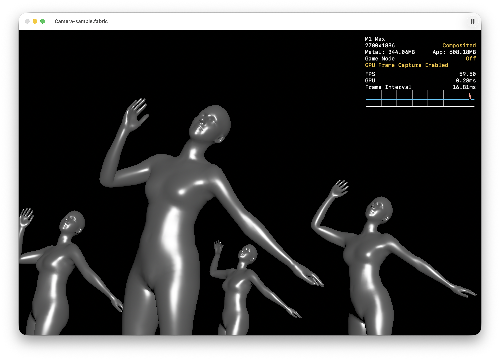

# Body Mesh Provider



A macOS [Fabric](https://github.com/Fabric-Project/Fabric) plug-in that reads
body-mesh assets generated by
[CMResearchKit](https://github.com/jvcleave/FabricBodyMeshProvider/releases/download/1.0/CMResearchKit-Example-1.0-arm64.dmg)
and exposes them as time-varying Satin geometry.

The plug-in provides **Body Mesh Character** for built-in and imported models,
**Body Mesh Provider** for geometry graphs, and **Body Mesh Intrinsic Camera**
for the generator app's source-camera framing.

## Body Mesh Provider

**Body Mesh Provider** is a time-based geometry node that reads a prepared
body-mesh asset folder created by the generator app. Select the folder—not its
individual `frames.bin` file—from the node's Settings panel. Choosing a folder
loads it on the next graph frame, even if it is already selected. The panel
reports compatibility, native frame rate, frame count, duration, and any
loading error.

The node reconstructs the requested archive frame as Satin geometry that can be
connected to Fabric's existing Mesh node and material system. It follows graph
time by default. Connect the **Time** input to use an external clock, or adjust
**Playback Rate** to speed up, slow down, or reverse graph-time playback.

Use **Confidence** to reject uncertain detections and **Maximum Bodies** to
limit how many of the highest-confidence people are included. Selected bodies
are combined into one geometry; the archive does not provide stable person
identities across frames.

Body Mesh Provider uses GPU skinning automatically. The CPU calculates CoMotion's
shape and pose corrections, and Satin's vertex shaders apply joint transforms
when drawing the mesh. Use a material that supports Satin skinning. A CPU reader
of the geometry sees positions before joint transforms on the GPU path. Frames
with projective joint transforms use CPU reconstruction for the per-vertex
perspective divide.

Along with **Geometry**, the node reports detected and output body counts,
current frame, native frame rate, frame count, duration, frame availability,
and source dimensions. The **Source Size** output can drive Body Mesh Intrinsic
Camera when source-matched framing is desired.

### Port reference

| Port | Direction | Fabric type | Default or requirement | Description |
| --- | --- | --- | --- | --- |
| `Time` | Input | `Float` | Graph time when unconnected | Playback position in seconds. When connected, this value is authoritative and `Playback Rate` is ignored. |
| `Loop` | Input | `Bool` | `true` | Wraps playback to the beginning when it reaches the end of the asset. When disabled, playback holds the first or last frame. |
| `Playback Rate` | Input | `Float` | `1` | Multiplies graph-time playback speed when `Time` is unconnected. Use values below `1` for slower playback, values above `1` for faster playback, or a negative value to play in reverse. |
| `Confidence` | Input | `Float` | `0.2`; range `0.05...1` | Minimum confidence required for a detected body to be included. |
| `Maximum Bodies` | Input | `Int` | `1`; range `1...8` | Maximum number of highest-confidence bodies merged into the geometry. |
| `Primitive` | Input | `String` menu | `Triangle` | Metal primitive used to render the geometry. Body meshes normally use `Triangle`. |
| `Geometry` | Output | `Geometry` | — | Selected bodies merged into one indexed Satin geometry. Connect this to Fabric's Mesh node. |
| `Detected Bodies` | Output | `Int` | — | Number of bodies stored in the current frame before confidence filtering. |
| `Output Bodies` | Output | `Int` | — | Number of bodies included after confidence filtering and the `Maximum Bodies` limit. |
| `Current Frame` | Output | `Int` | — | Zero-based archive frame represented by the current geometry. |
| `Frame Rate` | Output | `Float` | — | Native frame rate encoded in the selected asset. |
| `Frame Count` | Output | `Int` | — | Total number of frames in the selected asset. |
| `Duration` | Output | `Float` | — | Total asset duration in seconds. |
| `Frame Available` | Output | `Bool` | — | `true` when at least one body passes filtering for the current frame. |
| `Source Size` | Output | `Vector2` | — | Encoded source width and height. Connect this to `Body Mesh Intrinsic Camera` for source-matched framing. |

## Body Mesh Character

Add **Body Mesh Character** from Fabric's Loader group. The **Built-in** model
uses the same body reconstruction as the geometry provider. In Settings,
**Choose Character Model** opens a mapped Creator `.usdz` and **Use Built-in**
switches back to the built-in body. **Choose Motion Archive** accepts a Creator
`.messcapture` or generator folder containing `frames.bin`. An imported model
uses its reference pose until an archive is selected. With an archive, either
model uses the playback inputs in the table above and draws each selected
detection with its own pose and root translation.

Imported textures respond to Satin lighting. Character surfaces use the
authored alpha cutoff in both the visible image and the shadow map.

Add a Directional Light and connect **Source Size** to **Body Mesh Intrinsic
Camera** for source-matched framing. The model and archive choices are saved
independently for graph reopen and movie export.

The plug-in build requires Apple silicon, macOS 15.6 or newer, an Xcode
toolchain with Swift 6.2 or newer, and read access to the private
[MessUSDZImportKit repository](https://github.com/jvcleave/MessUSDZImportKIt).
Xcode embeds the OpenUSD and TBB frameworks and the USD schema resources in
the plug-in. [USDZ update plan](docs/internal/todos/USDZ_CHARACTER_MODEL_UPDATE_PLAN.md)

## Body Mesh Intrinsic Camera

**Body Mesh Intrinsic Camera** is an optional perspective-camera node designed
to reproduce the framing used by the body-mesh generator. Connect the Body Mesh
Provider's **Source Size** output to the camera's **Source Size** input.

The camera derives its field of view from the source dimensions and adjusts it
as the Fabric viewport changes. Its aspect-fit projection preserves the
generated mesh's original horizontal and vertical framing across different
output aspect ratios.

The camera defaults to the origin and looks along Fabric's negative Z axis,
matching the coordinate conversion performed by Body Mesh Provider. Position,
orientation, and scale remain available for creative adjustments.

This is a deterministic reconstruction of the generator's camera model. It
does not recover lens distortion, principal-point offsets, physical focal
length, or the original camera's position and orientation. Ordinary Fabric
cameras remain fully supported when source-matched framing is not required.

### Port reference

| Port | Direction | Fabric type | Default or requirement | Description |
| --- | --- | --- | --- | --- |
| `Source Size` | Input | `Vector2` | `(1920, 1080)` | Encoded source width and height. Connect the provider's `Source Size` output here. |
| `Orientation` | Input | `Vector4` | `(0, 0, 0, 1)` | Camera orientation as an `(x, y, z, w)` quaternion. The identity orientation looks along Fabric's negative Z axis. |
| `Scale` | Input | `Vector3` | `(1, 1, 1)` | Scales the camera view along each axis. |
| `Position` | Input | `Vector3` | `(0, 0, 0)` | Camera position in world units. Generated body meshes are calibrated with the camera at the origin. |
| `Visible` | Input | `Bool` | `true` | Inherited Fabric object visibility. Active-camera selection still follows Fabric's last-added-camera behavior. |
| `Render Order` | Input | `Int` | `0` | Inherited Fabric object setting; normally left at `0` for a camera. |

Body Mesh Intrinsic Camera has no output ports. Fabric discovers camera nodes in
the graph directly and uses its normal active-camera selection behavior.

## Generate body mesh assets

[](https://www.youtube.com/watch?v=XR2QLn5UtyI)

Download the notarized arm64 generator app from the
[Body Mesh Provider 1.0 release](https://github.com/jvcleave/FabricBodyMeshProvider/releases/download/1.0/CMResearchKit-Example-1.0-arm64.dmg).
Use it to generate a body-mesh asset folder, then select that folder from the
Body Mesh Provider node's Settings panel in Fabric. The app requires macOS 15
or later on Apple silicon.

## Development layout

The default local layout is:

```text
MAC_APPS/
├── Fabric/
└── BodyMeshProvider/
```

The Xcode target builds against an adjacent checkout of the
[Fabric repository](https://github.com/Fabric-Project/Fabric). Override its
location with the `FABRIC_SOURCE_ROOT` build setting when necessary.

## Build and install

Open `BodyMeshProvider/BodyMeshProvider.xcodeproj` and build the
`BodyMeshProvider` scheme, or run:

```sh
xcodebuild \
  -project BodyMeshProvider/BodyMeshProvider.xcodeproj \
  -scheme BodyMeshProvider \
  -configuration Debug \
  -destination 'platform=macOS' \
  build
```

The build prepares the matching Fabric Swift module, builds the plug-in, copies
the constants into its resources, installs it at the path below, and ad-hoc
signs the installed bundle:

```text
~/Library/Application Support/Fabric/Plugins/BodyMeshProvider.fabricplugin
```

Use the same build configuration for Fabric Editor and the plug-in. Restart
Fabric Editor after rebuilding because Fabric discovers plug-ins when its node
registry starts.

## Use in Fabric

### Character sample

Open [Character-sample.fabric](FabricScenes/Character-sample.fabric). It
connects **Source Size** to **Body Mesh Intrinsic Camera** and uses **Built-in**
with the included [24sectest archive](FabricScenes/947B44F8-C4C3-4666-93B5-73BD71CE231A).
Keep the graph beside the archive folder when moving the sample. In the node's
Settings, choose a Creator USDZ to see it follow the same motion or choose
another archive to keep moving the same model with a different capture.
Saving the scene in Fabric records the resolved archive URL for movie export.

### Geometry provider sample

Open [`FabricScenes/Sample.fabric`](FabricScenes/Sample.fabric) for a basic
working scene. The scene's sample asset is included at
[`FabricScenes/947B44F8-C4C3-4666-93B5-73BD71CE231A`](FabricScenes/947B44F8-C4C3-4666-93B5-73BD71CE231A),
but Fabric stores selected folders as absolute URLs. After cloning the
repository, re-link it once:

1. Select the **Body Mesh Provider** node in the sample scene.
2. Open its Settings and choose **Choose Asset Folder**.
3. Select the included `FabricScenes/947B44F8-C4C3-4666-93B5-73BD71CE231A`
   folder—not its individual `frames.bin` file.

### Four-body camera sample

Open [`FabricScenes/Camera-sample.fabric`](FabricScenes/Camera-sample.fabric)
and re-link the included asset folder as described above. For the original
four-performer example, expand the release archive and select its
`C00F9E45-6C83-4760-A700-BBF2A37D0380` directory in Body Mesh Provider Settings.
[Four-performer archive](https://github.com/jvcleave/FabricBodyMeshProvider/releases/download/1.0/C00F9E45-6C83-4760-A700-BBF2A37D0380.zip)

The scene connects **Source Size** to **Body Mesh Intrinsic Camera** and sets
**Maximum Bodies** to `4`, allowing all four performers in the sample to be
included when their confidence passes the node's threshold.

### Build a scene manually

To build a scene manually:

1. Add **Body Mesh Provider** from the Geometry node group.
2. Open the node's Settings and choose an output folder created by the generator
   app.
   The panel reports compatibility, native frame rate, frame count, duration,
   and any loading error. Use **Reload** after repairing an asset in place.
3. Connect **Geometry** to Fabric's existing Mesh node, then attach a material
   and render it normally.
4. Use graph time for ordinary playback, or connect **Time** to make an external
   clock authoritative.
5. For source-camera framing, add **Body Mesh Intrinsic Camera** and connect the
   provider's **Source Size** output to its **Source Size** input. The camera
   becomes the graph's active camera using Fabric's usual last-added-camera
   behavior.

The node exposes Loop, Playback Rate, Confidence, and Maximum Bodies controls,
plus body count, frame rate, frame count, duration, frame availability, and
source-size metadata.

## Tests

The core package has no Fabric, Satin, SwiftUI, or CMResearchKit dependency:

```sh
swift test --package-path BodyMeshProviderCore
```

The checked-in example asset is always exercised. Additional local archives
under `SampleData` are exercised when present and remain ignored by Git.

## Maintainer documentation

Find the implementation plan, archive contract, and verification references in
the [internal documentation index](docs/internal/INTERNAL_DOCUMENTATION.md).
